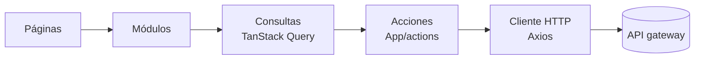

<div align="center">


# AirCrew Frontend

Interfaz web para gestionar las tripulaciones de Delta Air Lines en sus hubs de EE. UU., bajo la normativa de la FAA: tripulantes, supervisores y administradores coordinan vuelos, ausencias y reemplazos desde una sola aplicación.

[](https://github.com/AirCrew-Team/Aircrew-Frontend/actions/workflows/ci.yml)


</div>

<!-- TODO: agregar captura -->
<p align="center">
  
</p>

## Tabla de contenido

- [¿Por qué?](#por-qué)
- [Funcionalidades](#funcionalidades)
- [Stack tecnológico](#stack-tecnológico)
- [Inicio rápido](#inicio-rápido)
- [Uso](#uso)
- [Configuración](#configuración)
- [Arquitectura](#arquitectura)
- [Pruebas](#pruebas)
- [Despliegue en Railway](#despliegue-en-railway)
- [Hoja de ruta](#hoja-de-ruta)
- [Contribuir](#contribuir)
- [Licencia](#licencia)
- [Contacto](#contacto)

## ¿Por qué?

Cuando un tripulante no puede volar, encontrar un reemplazo suele depender de llamadas y hojas de cálculo, y cada minuto cuenta antes de la salida. AirCrew reúne en un solo lugar la programación, las ausencias, las certificaciones y los reemplazos, para que cada rol vea solo lo que necesita para actuar a tiempo.

## Funcionalidades

- **Una vista para cada rol.** Tripulante, supervisor y administrador entran por el mismo Login y cada uno ve su propio menú, así nadie se pierde entre opciones que no le corresponden.
- **Tripulaciones armadas sin errores.** El supervisor asigna la tripulación de cada vuelo de su base: solo ve a quien cumple las reglas (habilitación, descanso, horas, certificado médico) y puede pedir a la IA una sugerencia antes de confirmar.
- **Reemplazos más rápidos.** El supervisor ve quién de su base está de guardia y disponible, revisa los candidatos que propone el sistema, aprueba uno y sigue cada ausencia hasta que el reemplazo se confirma.
- **Ausencias sin papeleo.** El tripulante avisa al centro de control desde la app, con el motivo y el soporte médico, y quien lo cubra recibe la asignación en su Inicio.
- **Certificaciones al día.** Tripulantes y administradores ven qué licencias y exámenes vencen pronto, antes de que dejen a alguien sin poder volar.
- **Perfil propio.** Cada usuario actualiza sus datos de contacto, su foto, su contraseña y los avisos que quiere recibir.

## Stack tecnológico

| Área | Tecnologías |
| --- | --- |
| Base |     |
| Interfaz |    |
| Estado y datos |    |
| Formularios |   |
| Pruebas y calidad |      |

## Inicio rápido

**Requisitos**

- [Node.js](https://nodejs.org/) 22.22 o superior (el CI usa Node 24).
- [pnpm](https://pnpm.io/) 10.26, la versión fijada en `package.json`. Con Corepack se activa sola.

```bash
# 1. Clonar el repositorio
git clone https://github.com/AirCrew-Team/Aircrew-Frontend.git
cd Aircrew-Frontend

# 2. Activar pnpm (si no lo tienes) e instalar las dependencias
corepack enable
pnpm install

# 3. Crear el archivo de variables de entorno
cp .env.template .env

# 4. Levantar el servidor de desarrollo
pnpm dev
```

La app queda en <http://localhost:5173> (si el puerto está ocupado, Vite usa el siguiente libre).

> [!WARNING]
> El archivo `.env` es local y está en `.gitignore`. No lo subas al repositorio: el CI busca secretos con Gitleaks en cada push y pull request.

## Uso

La app arranca en el Login. Cada rol (tripulante, supervisor y administrador) ve su propio menú y sus propias pantallas.

Para recorrerla en desarrollo (`pnpm dev`), usa el selector **«Rol (dev)»** del Login: entra con el rol que elijas sin escribir credenciales y te deja cambiar de rol al instante. No se incluye en el build de producción.

> [!NOTE]
> El Login está conectado al backend de AirCrew a través de su API gateway. La sesión vive en una cookie `httpOnly` que crea el backend, así que sigue abierta al recargar la página hasta que vence el token. Con la sesión real, todas las pantallas usan el backend, salvo Reportes del administrador, que todavía no existe. Las cuentas demo («Rol (dev)») no llaman al backend y siguen con datos de ejemplo en memoria, que se reinician al recargar.

<details>
<summary>Generar y revisar el build de producción</summary>

```bash
pnpm build     # revisa los tipos con tsc y compila con Vite en dist/
pnpm preview   # sirve el build localmente
```

</details>

## Configuración

Las variables se leen desde `.env` (plantilla en [`.env.template`](.env.template)).

| Variable | Descripción | Por defecto | Obligatoria |
| --- | --- | --- | --- |
| `VITE_URL_API_BACKEND` | URL del API gateway que usa el cliente HTTP (`src/service/api-client.ts`). Sin ella, la app no arranca. | `http://localhost:3000` (en `.env.template`) | Sí |

> [!TIP]
> Las variables con prefijo `VITE_` terminan dentro del bundle que descarga el navegador. Nunca guardes claves ni secretos en ellas.

## Arquitectura

Arquitectura en capas organizada por páginas y módulos. Cada página solo compone módulos, y cada módulo pide sus propios datos y maneja su carga y su error, para que la falla de uno no tumbe la pantalla.



```text
src/
├── App/            # Acciones (única capa que llama al backend), tipos por dominio y recursos compartidos
├── components/     # Componentes base de shadcn/ui (ui/) y componentes propios genéricos (custom/)
├── hooks/          # Hooks genéricos, como la detección de inactividad
├── layouts/        # Diseño base compartido por todos los roles (navbar + contenido)
├── lib/            # Utilidades de librerías externas
├── modules/        # Secciones de cada pantalla, agrupadas por página; lo común va en shared/
├── pages/          # Una página por pantalla, agrupadas por rol
├── routes/         # Rutas, navegación y protección por rol
├── service/        # Cliente HTTP configurado con la URL del gateway
├── stores/         # Estado del cliente con Zustand (sesión)
└── tests/          # Pruebas unitarias y de componentes (Vitest) y su configuración
e2e/                # Pruebas de extremo a extremo (Playwright) y sus ayudas
docs/
├── adr/            # Decisiones de arquitectura
└── assets/         # Imágenes del README
```

Las decisiones de diseño están documentadas en los ADR:

- [ADR 001: Selección de estilo arquitectónico](docs/adr/adr-001-architectural-style-selection.md)
- [ADR 002: Estructura interna del repositorio](docs/adr/adr-002-Internal-Structure-Repository.md)
- [ADR 003: Estrategia de comunicación del frontend](docs/adr/adr-003-communication-strategy.md)

## Pruebas

El proyecto tiene dos niveles de pruebas, y el CI ejecuta los dos en cada push y pull request.

| Nivel | Herramienta | Dónde | Qué cubre |
| --- | --- | --- | --- |
| Unitarias y de componentes | Vitest + Testing Library (jsdom) | `src/tests/` | Lógica, rutas por rol, estados de carga y error, formularios e interacciones de cada pantalla |
| De extremo a extremo (E2E) | Playwright (Chromium) | `e2e/` | Flujos completos en un navegador real, contra el build de producción, en escritorio y en un móvil emulado |

### Unitarias

```bash
pnpm test:run    # ejecuta todas las pruebas una vez
pnpm test        # modo watch
pnpm typecheck   # revisión de tipos
pnpm lint        # ESLint
```

> [!TIP]
> `pnpm test:run` oculta la consola de las pruebas que pasan. Para ver los avisos de React o React Router, usa `pnpm exec vitest run --silent=false`.

### De extremo a extremo (Playwright)

Prueban lo que jsdom no puede ver: el layout real, las vistas previas de imágenes, las animaciones y el foco, además de los flujos críticos de cada rol:

- login por rol, credenciales incorrectas y protección de rutas;
- aprobar un reemplazo (supervisor) y reportar una ausencia (tripulante);
- el scroll de Ausencias, que muestra exactamente 2 tarjetas completas por columna;
- filtros y búsqueda de Tripulación;
- armar y confirmar la tripulación de un vuelo en Programación (a mano y con la sugerencia de la IA);
- foto de perfil y cambio de contraseña en Configuración;
- el menú del navbar en móvil;
- una revisión automática de accesibilidad (WCAG 2.1 AA) con axe en las pantallas principales.

La primera vez, descarga el navegador:

```bash
pnpm exec playwright install chromium
```

Después:

```bash
pnpm test:e2e                          # compila la app, la sirve y ejecuta todas las pruebas
pnpm test:e2e:ui                       # modo interactivo para ver y depurar cada paso
pnpm exec playwright test --project=movil   # solo las pruebas del móvil emulado
pnpm exec playwright show-report       # abre el reporte HTML de la última ejecución
```

> [!NOTE]
> Playwright compila la app (`pnpm build`) y la sirve con `vite preview` en el puerto 4173 antes de probar; no hace falta tener `pnpm dev` abierto. Si una prueba falla, el reporte guarda la captura, el video y la traza del fallo. En el CI se sube como artefacto `playwright-report`.

## Despliegue en Railway

En producción, la app se publica en Railway como **el único servicio con dominio público**. El `Dockerfile` la compila y la sirve con [Caddy](https://caddyserver.com/), que además reenvía `/api/*` al gateway del backend por la red privada de Railway:

```text
Navegador ──► dominio del frontend
                 ├─ /, /supervisor/programacion, /assets/...  → la app (dist/)
                 └─ /api/...  ──(red privada)──► gateway ──► servicios
```

El navegador habla con un solo dominio, así que la cookie de sesión (`SameSite=Lax`) funciona en todos los navegadores, también en Safari. El backend, PostgreSQL y sus variables se configuran según el README del repositorio del backend.

**Servicio `frontend` en Railway:**

- **Origen:** este repositorio. Railway detecta el `Dockerfile` de la raíz.
- **Dominio público:** sí, en el puerto `8080`.
- **Healthcheck path:** `/`.
- **Variables:**

| Variable | Valor | Obligatoria |
| --- | --- | --- |
| `PORT` | `8080` | Sí |
| `GATEWAY_URL` | `http://${{gateway.RAILWAY_PRIVATE_DOMAIN}}:3000` (URL privada del gateway) | Sí: sin ella, el contenedor no arranca |
| `VITE_URL_API_BACKEND` | `/` (ya es el valor por defecto del `Dockerfile`) | No |

**Qué hace Caddy (`Caddyfile`):**

- `/api/*` va al gateway con el prefijo intacto, incluido el stream de las alertas en vivo (`/api/notification/stream`). Las alertas van por SSE (Server-Sent Events): el navegador abre un `EventSource` que lleva la cookie de sesión, y Caddy no comprime ese stream y entrega cada aviso apenas llega.
- Cualquier otra ruta devuelve `index.html`, así que recargar con F5 en una pantalla no da 404.
- Caché:
  - `index.html` y las rutas de la app van con `Cache-Control: no-cache`, para que tras un despliegue nadie se quede con chunks viejos;
  - los archivos de `/assets/` van con caché de un año (`immutable`), porque Vite les pone un hash en el nombre;
  - un archivo de `/assets/` que no existe da 404.

**Probar la imagen en local** (con el backend corriendo en el equipo):

```bash
docker build -t aircrew-frontend .
docker run --rm -p 8080:8080 -e PORT=8080 -e GATEWAY_URL=http://host.docker.internal:3000 aircrew-frontend
```

Y abrir `http://localhost:8080`. En local la cookie no lleva `Secure`, así que funciona por http.

## Hoja de ruta

- [x] Login real, recuperación de contraseña y activación de cuenta; «Rol (dev)» para recorrer la app con datos de ejemplo
- [x] Tripulante: Inicio, Mis Vuelos, Reportar Ausencia, Certificaciones y Configuración
- [x] Supervisor: Inicio, Programación, Recomendaciones, Ausencias, Tripulación y Configuración
- [x] Administrador: Inicio, Usuarios, Aeronaves, Certificaciones y Configuración
- [x] Conectar con el API gateway (capa `App/actions` y cliente HTTP)
- [x] Tripulante: ver en «Mis Vuelos» las asignaciones que confirma el supervisor, con datos reales
- [x] Ausencias reales: reporte con soporte, tablero del supervisor y reemplazos
- [x] Programación y Tripulación del supervisor con datos reales
- [x] Configuración real para todos los roles
- [x] Alertas en vivo para el supervisor (SSE) y campana con historial
- [x] Adaptación a Delta Air Lines: hubs de EE. UU. y normativa FAA
- [x] Ejecutar las pruebas unitarias y E2E en el CI
- [ ] Administrador: Reportes
- [ ] Tripulación: distinguir «día libre» de «sin asignación»

## Contribuir

Las ramas salen de `develop` y vuelven a ella por pull request. Lee la [guía de contribución](CONTRIBUTING.md) antes de abrir uno.

## Licencia

> [!NOTE]
> El proyecto todavía no tiene una licencia definida. Mientras tanto, todos los derechos están reservados por sus autores.

## Contacto

Proyecto del equipo [AirCrew-Team](https://github.com/AirCrew-Team). Autores: Johan David Taborda Arroyave, Asley Torres Palacio y Samuel Arredondo Ospina.

Para reportar un error o proponer una mejora, abre un [issue](https://github.com/AirCrew-Team/Aircrew-Frontend/issues).
