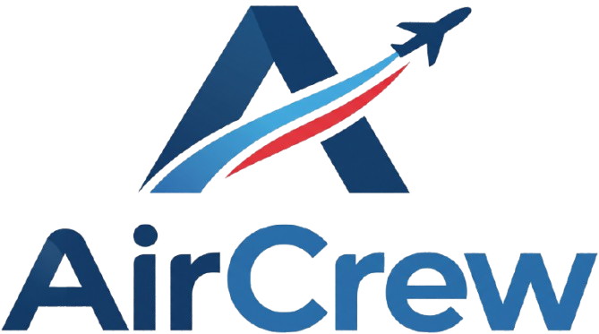
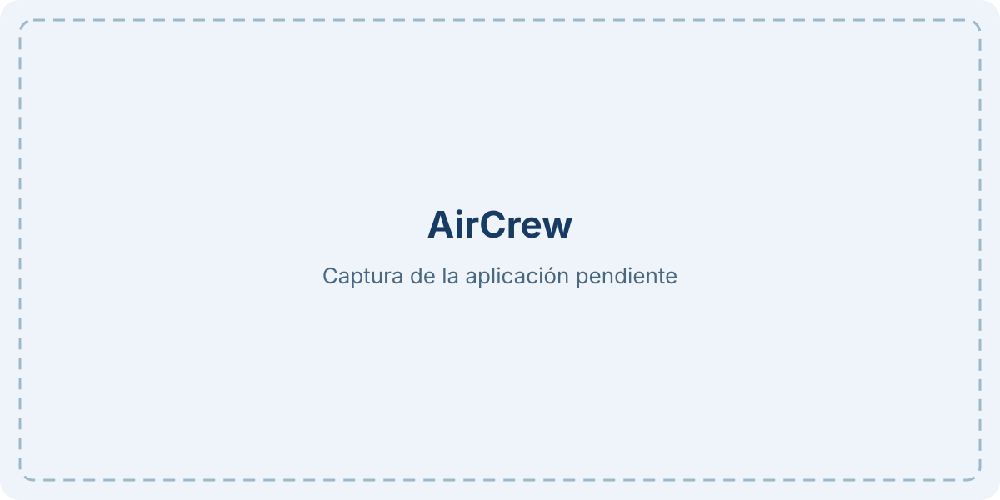
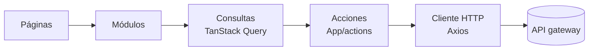

<div align="center">



# AirCrew Frontend

Interfaz web para gestionar tripulaciones aéreas: tripulantes, supervisores y administradores coordinan vuelos, ausencias y reemplazos desde una sola aplicación.

[](https://github.com/AirCrew-Team/Aircrew-Frontend/actions/workflows/ci.yml)


</div>

<!-- TODO: agregar captura -->
<p align="center">
  
</p>

## Tabla de contenido

- [¿Por qué?](#por-qué)
- [Funcionalidades](#funcionalidades)
- [Stack tecnológico](#stack-tecnológico)
- [Inicio rápido](#inicio-rápido)
- [Uso](#uso)
- [Configuración](#configuración)
- [Arquitectura](#arquitectura)
- [Pruebas](#pruebas)
- [Hoja de ruta](#hoja-de-ruta)
- [Contribuir](#contribuir)
- [Licencia](#licencia)
- [Contacto](#contacto)

## ¿Por qué?

Cuando un tripulante no puede volar, encontrar un reemplazo suele depender de llamadas y hojas de cálculo, y cada minuto cuenta antes de la salida. AirCrew reúne en un solo lugar la programación, las ausencias, las certificaciones y los reemplazos, para que cada rol vea solo lo que necesita para actuar a tiempo.

## Funcionalidades

- **Una vista para cada rol.** Tripulante, supervisor y administrador entran por el mismo Login y cada uno ve su propio menú, así nadie se pierde entre opciones que no le corresponden.
- **Reemplazos más rápidos.** El supervisor revisa los candidatos que propone el sistema, aprueba uno y sigue cada ausencia hasta que el reemplazo se confirma.
- **Ausencias sin papeleo.** El tripulante avisa al centro de control desde la app, con el motivo y el soporte médico, y quien lo cubra recibe la asignación en su Inicio.
- **Certificaciones al día.** Tripulantes y administradores ven qué licencias y exámenes vencen pronto, antes de que dejen a alguien sin poder volar.
- **Tripulación del turno a la vista.** El supervisor sabe quién de su base está de guardia, en vuelo, en descanso o ausente, y quién puede cubrir un reemplazo.
- **Perfil propio.** Cada usuario actualiza sus datos de contacto, su foto, su contraseña y los avisos que quiere recibir.

## Stack tecnológico

| Área | Tecnologías |
| --- | --- |
| Base |     |
| Interfaz |    |
| Estado y datos |    |
| Formularios |   |
| Pruebas y calidad |     |

## Inicio rápido

**Requisitos**

- [Node.js](https://nodejs.org/) 22.22 o superior (el CI usa Node 24).
- [pnpm](https://pnpm.io/) 10.26, la versión fijada en `package.json`. Con Corepack se activa sola.

```bash
# 1. Clonar el repositorio
git clone https://github.com/AirCrew-Team/Aircrew-Frontend.git
cd Aircrew-Frontend

# 2. Activar pnpm (si no lo tienes) e instalar las dependencias
corepack enable
pnpm install

# 3. Crear el archivo de variables de entorno
cp .env.template .env

# 4. Levantar el servidor de desarrollo
pnpm dev
```

La app queda en <http://localhost:5173> (si el puerto está ocupado, Vite usa el siguiente libre).

> [!WARNING]
> El archivo `.env` es local y está en `.gitignore`. No lo subas al repositorio: el CI busca secretos con Gitleaks en cada push y pull request.

## Uso

La app arranca en el Login. Cada rol (tripulante, supervisor y administrador) ve su propio menú y sus propias pantallas.

Para recorrerla en desarrollo (`pnpm dev`), usa el selector **«Rol (dev)»** del Login: entra con el rol que elijas sin escribir credenciales y te deja cambiar de rol al instante. No se incluye en el build de producción.

> [!NOTE]
> Por ahora no hay backend conectado: las cuentas y todos los datos son simulados y viven en memoria, así que se reinician al recargar la página.

<details>
<summary>Generar y revisar el build de producción</summary>

```bash
pnpm build     # revisa los tipos con tsc y compila con Vite en dist/
pnpm preview   # sirve el build localmente
```

</details>

## Configuración

Las variables se leen desde `.env` (plantilla en [`.env.template`](.env.template)).

| Variable | Descripción | Por defecto | Obligatoria |
| --- | --- | --- | --- |
| `VITE_URL_API_BACKEND` | URL del API gateway que usa el cliente HTTP (`src/service/api-client.ts`). | — | Sí, cuando se conecte la API. Hoy la app funciona con datos simulados y no la usa. |

> [!TIP]
> Las variables con prefijo `VITE_` terminan dentro del bundle que descarga el navegador. Nunca guardes claves ni secretos en ellas.

## Arquitectura

Arquitectura en capas organizada por páginas y módulos. Cada página solo compone módulos, y cada módulo pide sus propios datos y maneja su carga y su error, para que la falla de uno no tumbe la pantalla.



```text
src/
├── App/            # Acciones (única capa que llama al backend), tipos por dominio y recursos compartidos
├── components/     # Componentes base de shadcn/ui (ui/) y componentes propios genéricos (custom/)
├── hooks/          # Hooks genéricos, como la detección de inactividad
├── layouts/        # Diseño base compartido por todos los roles (navbar + contenido)
├── lib/            # Utilidades de librerías externas
├── modules/        # Secciones de cada pantalla, agrupadas por página; lo común va en shared/
├── pages/          # Una página por pantalla, agrupadas por rol
├── routes/         # Rutas, navegación y protección por rol
├── service/        # Cliente HTTP configurado con la URL del gateway
├── stores/         # Estado del cliente con Zustand (sesión)
└── tests/          # Pruebas automatizadas y su configuración
docs/
├── adr/            # Decisiones de arquitectura
└── assets/         # Imágenes del README
```

Las decisiones de diseño están documentadas en los ADR:

- [ADR 001: Selección de estilo arquitectónico](docs/adr/adr-001-architectural-style-selection.md)
- [ADR 002: Estructura interna del repositorio](docs/adr/adr-002-Internal-Structure-Repository.md)
- [ADR 003: Estrategia de comunicación del frontend](docs/adr/adr-003-communication-strategy.md)

## Pruebas

Las pruebas usan Vitest y Testing Library sobre jsdom, y viven en `src/tests/`.

```bash
pnpm test:run    # ejecuta todas las pruebas una vez
pnpm test        # modo watch
pnpm typecheck   # revisión de tipos
pnpm lint        # ESLint
```

> [!TIP]
> `pnpm test:run` oculta la consola de las pruebas que pasan. Para ver los avisos de React o React Router, usa `pnpm exec vitest run --silent=false`.

## Hoja de ruta

- [x] Login con cuentas de prueba y recuperación de contraseña
- [x] Tripulante: Inicio, Mis Vuelos, Reportar Ausencia, Certificaciones y Configuración
- [x] Supervisor: Inicio, Recomendaciones, Ausencias, Tripulación y Configuración
- [x] Administrador: Inicio, Usuarios, Certificaciones y Configuración
- [ ] Administrador: Reportes y Aeronaves
- [ ] Conectar con el API gateway (capa `App/actions` y cliente HTTP)
- [ ] Ejecutar las pruebas en el CI (hoy corre el escaneo de secretos, el lint y el build)

## Contribuir

Las ramas salen de `develop` y vuelven a ella por pull request. Lee la [guía de contribución](CONTRIBUTING.md) antes de abrir uno.

## Licencia

> [!NOTE]
> El proyecto todavía no tiene una licencia definida. Mientras tanto, todos los derechos están reservados por sus autores.

## Contacto

Proyecto del equipo [AirCrew-Team](https://github.com/AirCrew-Team). Autores: Johan David Taborda Arroyave, Asley Torres Palacio y Samuel Arredondo Ospina.

Para reportar un error o proponer una mejora, abre un [issue](https://github.com/AirCrew-Team/Aircrew-Frontend/issues).
